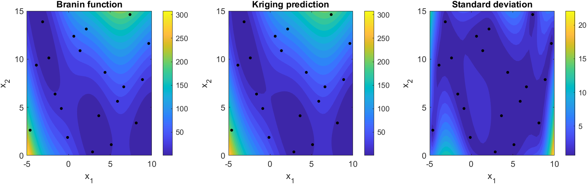
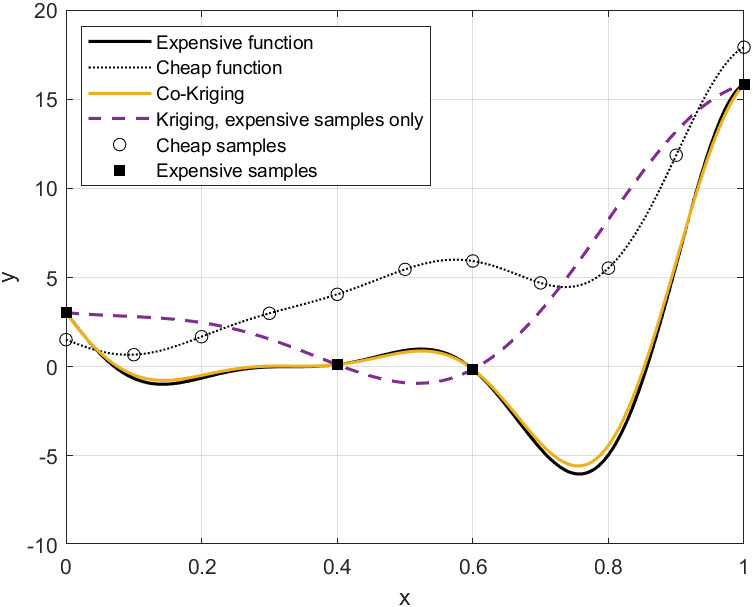
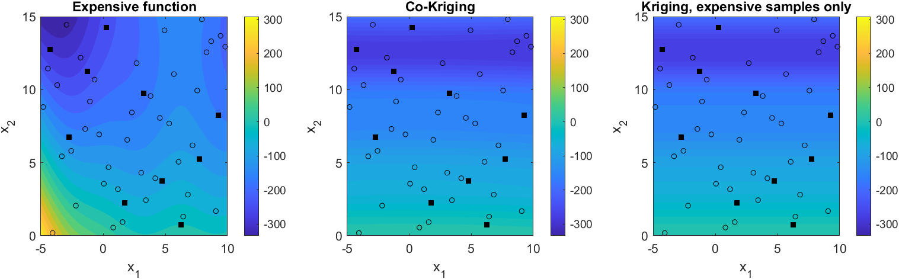
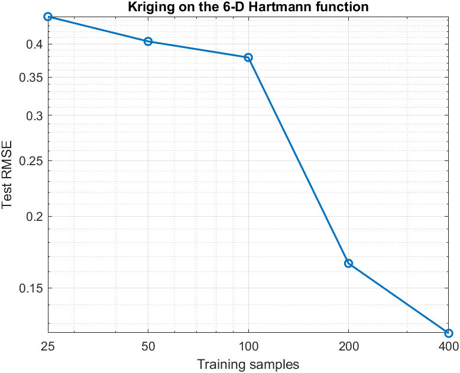
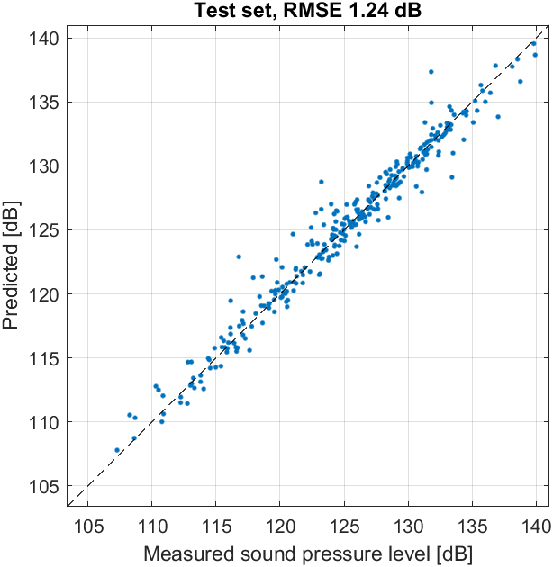

# kriging-surrogate

[](https://github.com/Marcodagostino2/kriging-surrogate/actions/workflows/tests.yml)

Kriging and AR(1) co-Kriging surrogate models in MATLAB. You provide the samples and the settings; the
library scales the inputs, fits the hyperparameters by maximum likelihood and returns predictions with
their variance.

The code is a standalone rewrite of the surrogate-modelling library I wrote for the Mission Analysis
team of Skyward Experimental Rocketry, the rocketry student association of Politecnico di Milano. There
it predicts the apogee of the rocket from its state after engine cutoff and combines DATCOM and CFD
aerodynamic coefficients. The apogee case study is documented in [docs/report.pdf](docs/report.pdf),
summarized [below](#apogee-case-study).

## Quick start

```matlab
addpath src

x = 10 * rand(30, 2);                      % 30 samples of two inputs
y = sin(x(:, 1)) + 0.1 * x(:, 2).^2;

model = kriging.KrigingModel.fit(x, y);    % ordinary Kriging, Gaussian kernel
[yHat, s2] = model.predict([2.5 4; 7 1]);  % mean and variance at two new points
```

The settings go in a `kriging.FitOptions` object:

```matlab
opts = kriging.FitOptions(TrendDegree=2, ExponentBounds=[1 2], NumStarts=10);
model = kriging.KrigingModel.fit(x, y, opts, InputBounds=[0 0; 10 10]);
```

| Option | Meaning | Default |
|---|---|---|
| `TrendDegree` | polynomial trend: 0 constant, 1 linear, 2 quadratic | 0 |
| `ExponentBounds` | bounds on the kernel exponents p; equal bounds fix them | `[2 2]` (Gaussian) |
| `LogThetaBounds` | bounds on log10 of the correlation parameters | `[-5 3]` |
| `NuggetBounds` | bounds on the nugget, relative to the process variance | `[1e-5 1e-2]` |
| `NumStarts` | optimizer starts | 5 |
| `Seed` | seed of the random starts | 0 |
| `Display` | `"off"`, or `"iter"` for one line per start | `"off"` |

Bounds given as a pair apply to every input; a 2-by-d matrix sets them input by input. Without
`InputBounds`, the inputs are scaled with the range of the training data.

Co-Kriging takes a cheap and an expensive data set and predicts the expensive function:

```matlab
mf = kriging.CoKrigingModel.fit(xLow, yLow, xHigh, yHigh, ...
    LowFidelity=kriging.FitOptions(), Discrepancy=kriging.FitOptions());
[yHat, s2] = mf.predict(xNew);
```

Trained models are ordinary MATLAB values: `save` and `load` them as they are.

## Method

- Correlation `R(x, x') = exp(-sum_k theta_k |x_k - x'_k|^p_k)` on inputs scaled to the unit cube,
  a nugget on the diagonal, and a polynomial trend estimated by generalized least squares (universal
  Kriging; degree 0 is ordinary Kriging). The output is standardized internally.
- The hyperparameters `[log10 theta, p, nugget]` maximize the concentrated likelihood. The analytic
  gradient goes to the SQP solver of `fmincon`, started from the centre of the bounds and from Latin
  hypercube points drawn with a fixed seed, so every fit is reproducible.
- `predict` returns the mean and the variance of the latent function; the nugget is not added to the
  variance.
- Co-Kriging follows the autoregressive model of Kennedy and O'Hagan,
  `yHigh(x) = rho * yLow(x) + delta(x)`. The cheap prediction enters the trend of the discrepancy as an
  extra regressor, so `rho` is estimated by least squares together with that trend.

## Examples

```matlab
addpath src examples
results = forresterCoKriging();
```

| Example | Data | Result |
|---|---|---|
| `braninKriging` | 20 samples of the Branin function | RMSE 3.936 on a 50 x 50 grid, R<sup>2</sup> 0.9945 |
| `hartmann6Convergence` | 25, 50, 100, 200, 400 samples of the 6-D Hartmann function | test RMSE from 0.446 to 0.125 |
| `airfoilNoise` | 1202 measured rows | test RMSE 1.24 dB, R<sup>2</sup> 0.965, noise from the nugget 0.81 dB |
| `forresterCoKriging` | 11 cheap and 4 expensive samples | RMSE 0.232 with co-Kriging (rho 1.89), 5.616 with Kriging |
| `braninCoKriging` | 40 cheap and 10 expensive samples | RMSE 57.501 with co-Kriging (rho -0.002), 56.982 with Kriging: the fidelities correlate at 0.15 only |

The two-fidelity Branin pair is kept as a negative case. Its cheap function follows the expensive one
poorly over the domain, so no scale `rho` turns it into a useful predictor, `rho` comes out close to
zero and co-Kriging does no better than Kriging on the expensive samples. The autoregressive model pays
off when the cheap function matches the expensive one up to a scale and a smooth correction, as in the
Forrester case.







`tools/makeReadmeAssets` reruns the examples and regenerates these figures and the table.

## Apogee case study

[docs/report.pdf](docs/report.pdf) applies the method to the apogee prediction of Hydra, a
liquid-propellant sounding rocket of Skyward Experimental Rocketry. A Kriging model maps six states
after engine cutoff (altitude, vertical and horizontal velocity, pitch, mass, air-brake extension) to
the apogee. The reference model (2000 training points, quadratic trend, Gaussian kernel) reaches:

| Metric | Test set (800 points) | Validation set (400 points) |
|---|---:|---:|
| RMSE | 0.77 m | 6.01 m |
| MAE | 0.39 m | 2.93 m |

The test targets come from the same ballistic propagation used for training. The validation targets are
the apogees of full 6-DOF simulations with wind and aerodynamic uncertainties, so the validation error
also contains the gap between the two models. A prediction takes about 34 µs (warmed-up median over
batched queries), about 1,900 times less than the ballistic propagation and 100,000 times less than
the 6-DOF simulation; absolute times depend on the machine. The report also covers model selection,
variance calibration and smaller models for constrained hardware. The data and the flight simulator
are not public and are not part of this repository.

## Repository layout

```
src/+kriging/            the library: KrigingModel, CoKrigingModel, FitOptions,
                         latinHypercube, errorMetrics
src/+kriging/+internal/  correlation, trend, likelihood, optimizer (not public API)
examples/                five examples; analytic benchmarks in +benchmarks, data in data/
tests/                   matlab.unittest suite
tools/                   makeReadmeAssets
docs/                    report and README figures
```

## Tests

```matlab
addpath src
results = runtests("tests", IncludeSubfolders=true);
```

Tested with MATLAB R2024b. Fitting needs the Optimization Toolbox (`fmincon`); nothing else is
required.

## References

- A. I. J. Forrester, A. Sóbester, A. J. Keane, *Engineering Design via Surrogate Modelling: A
  Practical Guide*, Wiley, 2008.
- M. C. Kennedy, A. O'Hagan, Predicting the output from a complex computer code when fast
  approximations are available, *Biometrika* 87(1), 1–13, 2000.
- H. Dong, B. Song, P. Wang et al., Multi-fidelity information fusion based on prediction of kriging,
  *Structural and Multidisciplinary Optimization* 51, 1267–1280, 2015 (two-fidelity Branin, as
  implemented in [mf2](https://github.com/sjvrijn/mf2)).
- S. Surjanovic, D. Bingham, Virtual Library of Simulation Experiments,
  https://www.sfu.ca/~ssurjano/ (Branin, Hartmann, Forrester).
- T. Brooks, D. Pope, M. Marcolini, Airfoil Self-Noise, UCI Machine Learning Repository, 1989,
  https://doi.org/10.24432/C5VW2C.

## License

MIT, see [LICENSE](LICENSE). The airfoil data keep their CC BY 4.0 license, see
[examples/data/README.md](examples/data/README.md).
